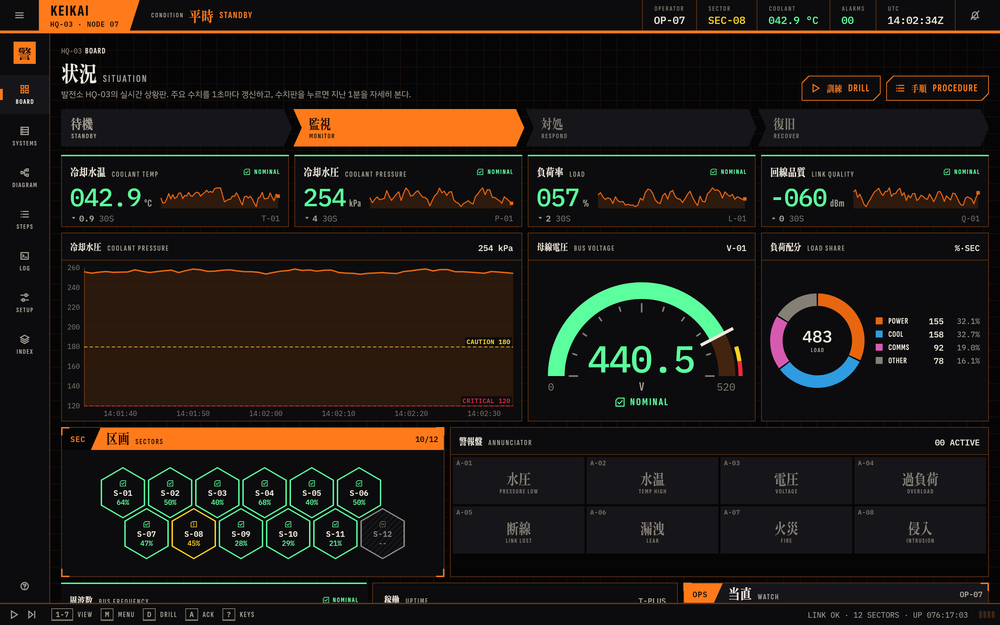
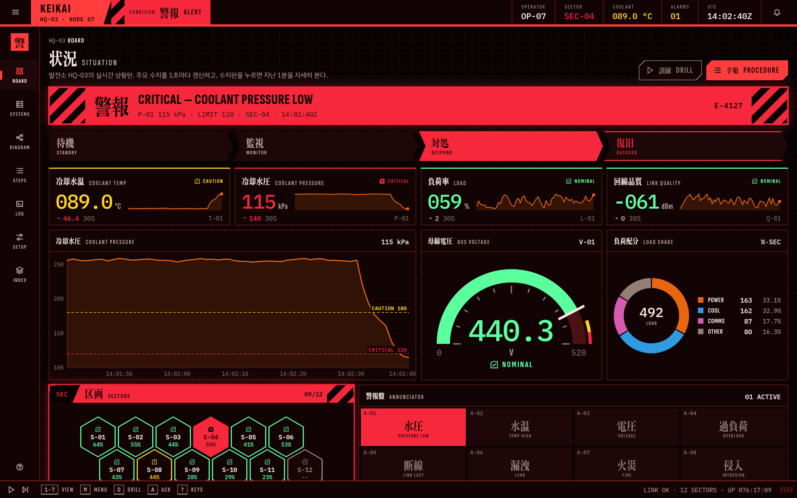

# KEIKAI 警戒 for Flutter

지휘소(HQ)·HUD 화면용 다크 디자인 언어 KEIKAI의 Flutter 구현입니다. 검은 바탕 위 신호 오렌지 프레임, 굵은 명조 漢字/한글 표제와 압축 영문 라벨, 고정폭 계측 숫자, 해저드 사선과 단계식 모션으로 "감시 중인 시스템"을 보여 줍니다. 평시에는 오렌지, 경보 시에는 화면 전체가 적색으로 바뀝니다.

모든 위젯은 Flutter의 `widgets`·`rendering` 레이어 위에 직접 만들었습니다. `material.dart`와 `cupertino.dart`는 어디에서도 import하지 않으며, 이 패키지의 위젯만으로 앱 전체를 만들 수 있습니다(`example/`이 그 증명입니다).





## 시작

```yaml
dependencies:
  keikai:
    git: https://github.com/itsmekingtiger/keikai-flutter
```

```dart
import 'package:keikai/keikai.dart';

void main() => runApp(const HqApp());

class HqApp extends StatelessWidget {
  const HqApp({super.key});

  @override
  Widget build(BuildContext context) {
    return const KeikaiApp(
      title: 'HQ',
      home: KkBackdrop(
        alignment: Alignment.center,
        child: KkLabel(cjk: '警戒', en: 'keikai for flutter', cjkSize: 44, enSize: 13),
      ),
    );
  }
}
```

`package:keikai/keikai.dart` 하나만 import하면 됩니다. 프레임워크의 `widgets` 레이어(`State`, `BuildContext`, `Navigator` …)를 함께 내보냅니다. 폰트 다섯 벌(Zen Old Mincho, Noto Serif KR, Sofia Sans Extra Condensed, IBM Plex Mono, IBM Plex Sans KR)은 패키지에 들어 있어 따로 선언할 것이 없습니다.

## 원칙

- 밀도가 장식보다 우선이다. 면은 명도와 선으로 나누고 그라데이션·둥근 모서리·그림자를 쓰지 않는다. 모서리를 줄일 때는 45°로 깎는다.
- 상태는 색 + 단어 + 상태 아이콘 세 가지로 말한다(`KkLevel`: nominal · caution · critical · offline).
- `signal`(오렌지)은 구조와 조작의 색이다. 상태의 색으로 쓰지 않는다.
- 모션은 계단식(`steps()`)이고 이징이 없다. 움직임은 상태 전이를 알릴 때만 쓴다.
- 표제는 두 언어로 쓴다: CJK 표제 + 영문 대문자 부제(`cjk` / `en`).

## 구성

아홉 계열이 있고, 계열마다 모든 위젯과 상태를 한 장에 모은 카탈로그 시트가 있습니다(`example/lib/sheets/`). 시트는 골든 이미지로 고정돼 있습니다(`test/<계열>/goldens/`).

| 시트 | 계열 | 경로 | 위젯 |
| --- | --- | --- | --- |
| F-01 | 基盤 기반 | `foundation` `painting` `motion` `widgets` `app` | `KeikaiApp` `KeikaiTheme` `KkColors` `KkTypography` `KkMetrics` `KkLevel` `KkIcon`(104종) `KkGlyph` `KkText` `KkLabel` `KkPressable` `KkBrackets` `KkBackdrop` `KkClock` `KkPageRoute` `KkPage` |
| F-02 | 配置 레이아웃 | `layout` | `KkScreen` `KkGrid` `KkCell` `KkRow` `KkColumn` `KkFlex` `KkWrap` `KkLayers` `KkBox` `KkSurface` `KkSplit` `KkScroll` `KkListView` `KkBreakpoint` `KkResponsive` `KkGap` |
| F-03 | 操作 조작 | `controls` | `KkButton` `KkIconButton` `KkFab` `KkBadge` `KkSegmented` `KkChip` `KkCheckbox` `KkRadioGroup` `KkSwitch` `KkSlider` `KkProgress` `KkRing` `KkStatusTag` `KkKbd` `KkDivider` `KkSkeleton` `KkEmpty` |
| F-04 | 入力 입력 | `inputs` | `KkTextField` `KkTextInput` `KkSelect` `KkSearch` `KkMenu` `KkMenuAnchor` `KkPopup` `KkTooltip` `KkDatePicker` `KkTimePicker` `KkTimeRange` |
| F-05 | 航法 셸·겹침면 | `shell` | `KkCommandBar` `KkTabs` `KkTabView` `KkNavRail` `KkNavDrawer` `KkToolbar` `KkBreadcrumbs` `KkDialog` `KkSheet` `KkSnackbar` `KkMessenger` `KkList` `KkCarousel` |
| F-06 | 計測 계측 | `hud` | `KkPanel` `KkAlertBar` `KkReadout` `KkMeter` `KkTimer` `KkHexMatrix` `KkDataLog` `KkSequence` `KkAnnunciator` `KkConsensus` `KkModeStrip` `KkHeading` `KkEmergency` |
| F-07 | 図表 차트 | `charts` | `KkStat` `KkDelta` `KkSparkline` `KkTimeSeries` `KkBarChart` `KkBarList` `KkGauge` `KkDonut` `KkHeatmap` `KkStatusTimeline` `KkCategoryBar` `KkRadar` `KkWaterfall` `KkTrace` |
| F-08 | 線図 다이어그램 | `diagram` | `KkDiagram` `KkDiagramView` `KkNodeGraph` `KkSequenceDiagram` · 배치 `KkLayeredLayout` `KkTreeLayout` `KkRadialLayout` `KkForceLayout` `KkManualLayout` · 배선 `KkEdgeRouter` |
| F-09 | 表 표 | `table` | `KkDataTable` `KkTableColumn` `KkTableWidth` `KkTableBulkAction` `KkPagination` · 칸 `KkTableLevel` `KkTableCode` `KkTableValue` `KkTableBar` `KkTableMeter` `KkTableSpark` `KkTableSummary` |

모션 위젯은 기반 계열에 있습니다: `KkBoot` `KkFlicker` `KkGrow` `KkBlink` `KkStrobe` `KkScramble` `KkSteppedValue` `KkStagger` `KkHazard` `KkMarquee` `KkCrt` `KkGlitch`.

## 테마와 조건

```dart
KeikaiApp(
  theme: const KeikaiThemeData(
    motion: KkMotion(timeScale: 1.0), // KkMotion.off 로 모션 전체 끄기
    metrics: KkMetrics(gridGutter: 8), // 치수 토큰 재정의
  ),
  condition: KkCondition.standby, // alert 로 바꾸면 화면이 글리치 후 적색으로 전환
  home: home,
);
```

- 조건은 `standby`와 `alert` 둘입니다. `condition`을 주지 않으면 앱이 스스로 들고 있고, `KeikaiApp.setCondition(context, KkCondition.alert)`로 바꿉니다.
- 영역 하나만 경보색으로 바꾸려면 `KkConditionScope(condition: KkCondition.alert, child: …)`를 씁니다. 그 아래의 상태(State)는 조건이 바뀌어도 유지됩니다.
- 색은 `KeikaiTheme.of(context).colors`(또는 `context.kk.colors`)에서만 꺼냅니다. 수준별 색은 `colors.level(KkLevel.caution)`.
- 운영체제의 "동작 줄이기" 설정이나 `KkMotion.off`에서는 모든 위젯이 애니메이션 없이 최종 상태를 보여 줍니다.
- 본문 서체에 없는 한자는 패키지에 든 명조로 대체됩니다. 시스템 서체로 대체하려면 `KkTypography(bodyFallback: [])`를 넘기세요.

## 화면 골격과 그리드

`KkScreen`은 지휘 띠·항법·본문·측면·하단 띠 다섯 구역을 자기 너비에 따라 배치합니다(840px 이상: 항법 | 본문 | 측면, 600–839px: 측면이 본문 아래로, 600px 미만: 한 열에 항법이 하단 막대로). `KkGrid`는 너비에 따라 4·8·12·16·24열이 되고, 행 단위는 48px, 거터는 8px로 고정입니다.

```dart
class SituationBoard extends StatelessWidget {
  const SituationBoard({super.key});

  @override
  Widget build(BuildContext context) {
    return KkScreen(
      commandBar: const KkCommandBar(
        name: 'KEIKAI',
        node: 'HQ-03 · NODE 07',
        followCondition: true,
        cells: <Widget>[
          KkCommandCell(label: 'sector', value: 'SEC-04'),
          KkCommandCell(label: 'coolant', value: '042.7 °C', level: KkLevel.nominal),
        ],
      ),
      nav: KkNavRail(
        index: 0,
        onChanged: (int index) {},
        items: const <KkNavItem>[
          KkNavItem(icon: KkIcons.grid, label: 'board'),
          KkNavItem(icon: KkIcons.table, label: 'systems'),
          KkNavItem(icon: KkIcons.node, label: 'diagram'),
        ],
      ),
      body: const KkGrid(
        children: <Widget>[
          KkCell(
            span: 8,
            rows: 5,
            child: KkPanel(code: 'SEC-04', cjk: '冷却', en: 'coolant loop', child: KkText('보조 펌프 B 대기 중.')),
          ),
          KkCell(
            span: 4,
            rows: 5,
            child: KkReadout(cjk: '水圧', en: 'pressure', value: '256', unit: 'kPa', level: KkLevel.nominal),
          ),
        ],
      ),
      footer: const KkToolbar(
        hints: <KkToolbarHint>[KkToolbarHint(keys: 'F1', label: 'help')],
        status: 'LINK OK',
      ),
    );
  }
}
```

행과 열은 `KkRow` / `KkColumn`(`gap`, `main`, `cross`, `shrinkWrap`)으로, 창 크기에 따른 값은 `KkResponsive`로 고릅니다.

```dart
final int columns = const KkResponsive<int>(compact: 1, medium: 2, expanded: 3).of(context);
```

## 조작과 입력

```dart
KkColumn(
  gap: 16,
  shrinkWrap: true,
  cross: KkCrossAlign.start,
  children: <Widget>[
    KkTextField(cjk: '識別符号', en: 'call sign', placeholder: 'SEC-04', maxLength: 6, onChanged: (String v) {}),
    KkSelect<String>(
      cjk: '区画',
      en: 'sector',
      value: sector,
      onChanged: (String? v) => setState(() => sector = v ?? sector),
      options: const <KkSelectOption<String>>[
        KkSelectOption<String>(value: 'power', label: 'Power', cjk: '電源', code: 'SEC-01'),
        KkSelectOption<String>(value: 'coolant', label: 'Coolant', cjk: '冷却', code: 'SEC-04'),
      ],
    ),
    KkSlider(cjk: '設定圧', en: 'set point', value: setPoint, onChanged: (double v) => setState(() => setPoint = v)),
    KkSwitch(value: auto, onChanged: (bool v) => setState(() => auto = v)),
    KkRow(
      gap: 8,
      shrinkWrap: true,
      children: <Widget>[
        KkButton(label: 'cancel', variant: KkButtonVariant.ghost, onPressed: () {}),
        KkButton(
          label: 'execute',
          cjk: '実行',
          variant: KkButtonVariant.primary,
          onPressed: () => confirmStop(context),
        ),
      ],
    ),
  ],
);
```

## 겹침면

대화상자·시트·메뉴·툴팁·스낵바는 페이드 없이 계단식 와이프로 열립니다. `KeikaiApp`이 `KkMessenger`를 올려 두므로 어느 화면에서든 스낵바를 띄울 수 있습니다.

```dart
Future<void> confirmStop(BuildContext context) async {
  final bool stop = await showKkConfirm(
    context: context,
    code: 'E-4127',
    cjk: '緊急停止',
    en: 'emergency stop',
    message: '주 펌프 A를 즉시 정지합니다.',
    confirmLabel: 'stop',
    confirmCjk: '停止',
    danger: true,
  );
  if (stop && context.mounted) {
    KkMessenger.of(context).show(code: 'SEC-04', message: 'pump A stopped', level: KkLevel.caution);
  }
}
```

그 밖에 `showKkDialog`, `showKkSheet`(측면·하단), `showKkMenu` / `KkMenuAnchor`, `KkTooltip`, 전면 비상 화면 `showKkEmergency`가 있습니다.

## 계측

```dart
const KkColumn(
  gap: 8,
  shrinkWrap: true,
  cross: KkCrossAlign.start,
  children: <Widget>[
    KkAlertBar(
      level: KkLevel.critical,
      cjk: '警報',
      title: 'coolant pressure low',
      sub: '冷却水圧 低下 · SEC-04',
      code: 'E-4127',
    ),
    KkMeter(cjk: '負荷', en: 'load', value: 0.78, unit: '%', valueText: '078'),
    KkTimer.countdown(from: Duration(minutes: 5), cjk: '猶予', en: 'hold', autostart: false),
  ],
);
```

## 차트

계열 색은 고정 순서 셋이고 넷째부터는 OTHER로 묶입니다. 차트는 포인터와 키보드로 값을 읽을 수 있습니다.

```dart
const KkTimeSeries(
  cjk: '水温',
  en: 'coolant temp',
  series: <KkSeries>[
    KkSeries(name: 'loop a', values: <double>[41.2, 41.9, 42.4, 43.8, 47.1, 52.6, 58.0], area: true),
    KkSeries(name: 'loop b', values: <double>[40.8, 40.9, 41.3, 41.2, 41.8, 42.0, 42.3]),
  ],
  thresholds: <KkThreshold>[KkThreshold(55, label: 'limit', level: KkLevel.critical)],
);
```

## 다이어그램

노드와 배선을 모델(`KkDiagram`)로 주거나 텍스트로 기술합니다. 배치는 다섯 가지(계층·트리·방사·힘·수동), 배선은 세 가지(직교·팔방·직선)이며 선은 직선과 45° 사선만 씁니다.

```dart
const String signalPath = '''
flow LR
SEN>PT-104] ==> ADC[ADC-02|SAMPLER]
ADC ==> FLT[DSP-01|FILTER|濾波]
FLT ==> CMP{LIMIT}
CMP -->|IN RANGE| LOG[LOG-01|ARCHIVE]
CMP ==>|OVER|:::critical ALM((ANN-07|ALARM|警報)):::critical
ALM -.-> PGR[PGR-03|PAGER]:::offline
''';

KkNodeGraph(diagram: KkDiagram.parse(signalPath), cjk: '信号経路', en: 'signal path', height: 280);
```

`KkDiagramView`는 틀 없는 뷰(확대·이동·선택), `KkSequenceDiagram`은 참여자 사이의 메시지 순서도입니다.

## 표

정렬·필터·선택과 일괄 조작·상세 행·칸 안 편집·쪽 이동을 갖춘 표입니다. 값이 바뀐 칸은 한 번 번쩍이고, 수준이 바뀐 행은 세 번 깜빡입니다.

```dart
KkDataTable<Pump>(
  code: 'TBL-01',
  cjk: '機器一覧',
  en: 'equipment',
  rows: pumps,
  rowKey: (Pump p) => p.id,
  rowLevel: (Pump p) => p.level == KkLevel.critical ? KkLevel.critical : null,
  selection: KkTableSelection.multi,
  filterable: true,
  pageSize: 8,
  bulkActions: <KkTableBulkAction>[
    KkTableBulkAction(label: 'acknowledge', cjk: '確認', onPressed: (Set<Object> keys) {}),
    KkTableBulkAction(label: 'trip', cjk: '遮断', danger: true, onPressed: (Set<Object> keys) {}),
  ],
  columns: <KkTableColumn<Pump>>[
    KkTableColumn<Pump>(
      id: 'id',
      cjk: '符号',
      en: 'id',
      value: (Pump p) => p.id,
      cell: (BuildContext context, Pump p) => KkTableCode(p.id),
    ),
    KkTableColumn<Pump>(
      id: 'name',
      cjk: '名称',
      en: 'name',
      value: (Pump p) => p.name,
      width: const KkTableWidth.flex(),
      sortable: true,
    ),
    KkTableColumn<Pump>(
      id: 'temp',
      cjk: '水温',
      en: 'temp',
      unit: '°C',
      numeric: true,
      sortable: true,
      value: (Pump p) => p.temp,
      format: (Pump p) => p.temp.toStringAsFixed(1),
    ),
    KkTableColumn<Pump>(
      id: 'load',
      cjk: '負荷',
      en: 'load',
      value: (Pump p) => p.load,
      cell: (BuildContext context, Pump p) => KkTableMeter(p.load),
    ),
    KkTableColumn<Pump>(
      id: 'state',
      cjk: '状態',
      en: 'state',
      value: (Pump p) => p.level.index,
      cell: (BuildContext context, Pump p) => KkTableLevel(level: p.level),
    ),
  ],
);
```

위험한 일괄 조작(`danger: true`)은 첫 누름에 장전되고 두 번째 누름에 실행됩니다.

## 모션

| 동작 | 길이 | 계단 |
| --- | --- | --- |
| 등장 와이프 (`KkBoot`, 페이지 전환) | 0.42s | 7 |
| 플리커 (`KkFlicker`) | 0.50s | 10 |
| 값 갱신 스크램블 (`KkScramble`) | 0.46s | 10 |
| 미터 전이 (`KkSteppedValue`) | 0.45s | 9 |
| 스트로브·블링크 (`KkStrobe`, `KkBlink`) | 1.20s | 켜짐/꺼짐 |
| 해저드 흐름 (`KkHazard(running: true)`) | 0.90s | — |
| 경보 진입 글리치 (`KkGlitch`) | 0.50s + 적색 점멸 0.70s | — |

```dart
KkColumn(
  gap: 8,
  shrinkWrap: true,
  cross: KkCrossAlign.start,
  children: <Widget>[
    const KkBoot(child: KkText.en('wiped in over 0.42s in 7 steps')),
    KkScramble(reading), // 값이 바뀌면 숫자가 섞였다가 자리 잡는다
    const KkBlink(child: KkText.en('standing by')),
    const KkHazard(running: true, height: 8, width: 200),
  ],
);
```

반복 동작은 하나의 프레임 시계를 같이 써서 화면 전체가 같은 박자로 깜빡입니다. `KkMotion(timeScale: 2)`는 모든 동작을 두 배 느리게 합니다.

## 예제 앱

`example/`은 이 패키지의 위젯만으로 만든 관제 콘솔입니다(상황판, 계통 표, 선도, 절차, 기록, 설정, 위젯 목록). `test/example_keikai_only_test.dart`가 예제의 모든 생성자 호출을 검사해 `Row`, `Container`, `Text` 같은 프레임워크 위젯이 하나라도 섞이면 실패합니다.

```bash
cd example
```

```bash
flutter run -d chrome
```

## 개발

```bash
flutter analyze
```

```bash
flutter test
```

- 카탈로그 시트와 예제 화면은 골든 이미지로 비교합니다. 그림이 바뀌는 수정을 했다면 `flutter test --update-goldens`로 다시 만들고 차이를 눈으로 확인하세요. 골든은 Linux에서 렌더한 것이며 다른 OS에서는 비교를 건너뜁니다.
- 레이아웃 테스트는 프레임워크의 렌더 박스 자기 검사(건식 레이아웃·건식 기준선·고유 크기)를 켠 채로 돕니다(`test/layout/layout_util.dart`의 `testChecked`).
- 이 문서의 코드 예제는 `test/readme_test.dart`에서 컴파일하고 렌더합니다.

## 폰트

패키지에 든 폰트는 모두 SIL Open Font License 1.1을 따르며, 각 라이선스 전문은 `fonts/OFL-*.txt`에 있습니다.
